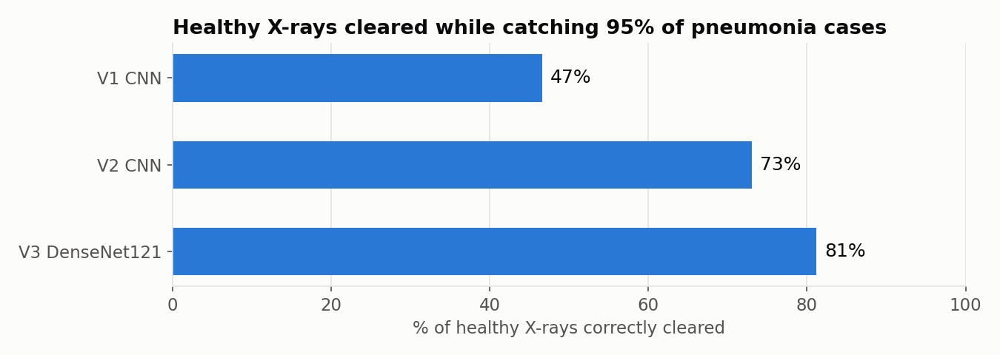
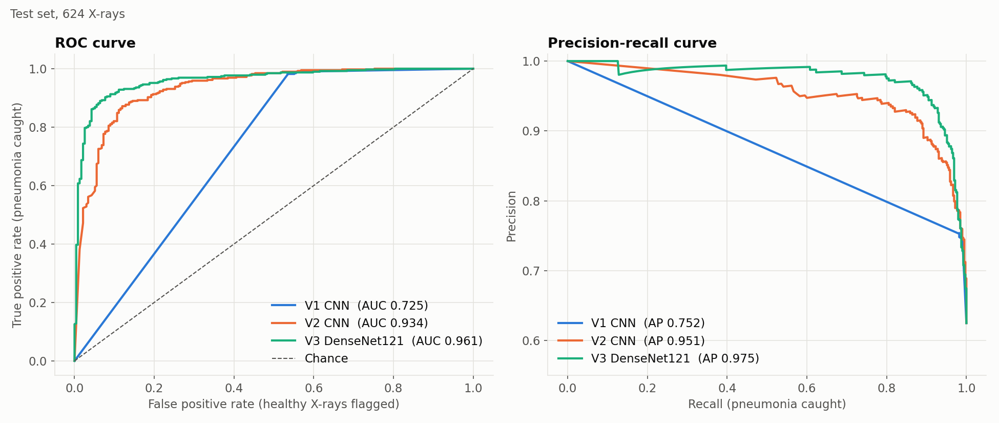
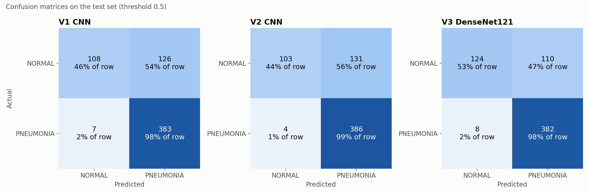

# Pneumonia Detection from Chest X-Rays

Deep learning models built with **TensorFlow/Keras** that classify paediatric chest X-ray images as **NORMAL** or **PNEUMONIA**.

The project has three iterations: a quick baseline CNN, a deeper CNN with grayscale preprocessing and class weighting, and a transfer-learning model built on a pretrained DenseNet121. A comparison notebook runs all three on the same test set.

> ⚠️ This is an educational project. It is not a medical device and must not be used for diagnosis.

---

## Results at a glance

All three models evaluated on the same 624 test X-rays, which none of them saw during training.

| Test set (624 X-rays) | V1 CNN | V2 CNN | V3 DenseNet121 |
|---|---:|---:|---:|
| Accuracy (threshold 0.5) | 78.7% | 78.4% | **81.1%** |
| Pneumonia recall (sensitivity) | 98.2% | **99.0%** | 97.9% |
| Normal recall (specificity) | 46.2% | 44.0% | **53.0%** |
| Precision | 75.2% | 74.7% | **77.6%** |
| ROC-AUC | 0.725 | 0.934 | **0.961** |
| PR-AUC | 0.752 | 0.951 | **0.975** |
| Normal recall at 95% pneumonia recall | 46.6% | 73.1% | **81.2%** |
| **Accuracy with threshold tuned on validation** | | 82.2% | **85.3%** |

At the default 0.5 threshold all three models lean heavily towards predicting pneumonia, so their accuracy looks similar. The fairer comparison is at the same safety level: when each model is set to catch 95% of pneumonia cases, V3 correctly clears **81%** of healthy X-rays, against 73% for V2 and 47% for V1.





V1's ROC curve is almost a straight line because it outputs probabilities very close to 0 or 1, so it gives almost no ranking between confident and borderline cases.



**Is V3's improvement over V2 real?** Its ROC-AUC gain is: a bootstrap over the test set gives +0.027 (95% CI +0.011 to +0.045). The accuracy gain at threshold 0.5 is not yet conclusive: V3 fixes 52 of V2's mistakes but introduces 35 new ones (McNemar's test p = 0.086).

---

## Dataset

The [Chest X-Ray Images (Pneumonia)](https://www.kaggle.com/datasets/paultimothymooney/chest-xray-pneumonia) dataset from Kaggle (Kermany et al.). It is not stored in this repo: download it and extract it into `data/` so it looks like this:

```
data/
  train/ NORMAL/  PNEUMONIA/
  val/   NORMAL/  PNEUMONIA/
  test/  NORMAL/  PNEUMONIA/
```

| Split | Normal | Pneumonia | Total |
|---|---:|---:|---:|
| Train | 1,000 | 3,875 | 4,875 |
| Validation | 8 | 8 | 16 |
| Test | 234 | 390 | 624 |

The training set is heavily imbalanced (~1 : 3.9), and the provided validation set is too small to be useful. V2 and V3 therefore merge it into training and hold out their own **patient-grouped validation split**: ~14% of images (688), stratified by class, with no patient's X-rays in both training and validation. Many patients have several X-rays, so a random split would leak near-duplicate images between the two.

---

## V1: Baseline CNN ([`classifier.ipynb`](classifier.ipynb))

- **Cleaning:** scans every split and removes corrupt or non-image files (OpenCV + `filetype`)
- **Input:** 256×256 RGB, raw 0–255 pixel values, loaded with `image_dataset_from_directory`
- **Architecture:** 3 × (Conv2D → MaxPool) with 16/32/16 filters → Dense(256) → sigmoid output (~3.7M parameters)
- **Training:** Adam, binary cross-entropy, 20 epochs, TensorBoard logging, validated on the 16-image `val/` folder

Training accuracy reached 100% while test performance stayed far lower: the model overfits and is overconfident, which shows up as its poor ROC-AUC.

## V2: Deeper CNN ([`classifierV2.ipynb`](classifierV2.ipynb))

Changes made to tackle V1's overfitting and the class imbalance:

- **Preprocessing:** images converted to **grayscale** and resized to **196×196** with OpenCV, with pixels scaled to [0, 1]. X-rays carry no colour information, so this cuts input size by two thirds.
- **Architecture:** five convolutional blocks, each with two stacked Conv2D layers (8 → 16 → 32 → 64 → 128 filters, kernels 7×7 → 5×5 → 3×3), followed by Dense(128), **Dropout(0.2)** and a 2-class softmax
- **~370K parameters**, about 10× fewer than V1 despite being much deeper
- **Class weighting** `{normal: 6.0, pneumonia: 0.5}` to stop the model defaulting to the majority class
- **Optimiser:** Adam (lr = 1e-4) with categorical cross-entropy
- **Early stopping** (patience 6) on validation loss, restoring the best weights
- **Evaluation:** confusion matrix, per-class precision/recall/F1, ROC-AUC, ROC and precision-recall curves, plus a decision threshold tuned on the validation set to keep pneumonia recall ≥ 95%

V2 is nearly perfect on its validation set but flags about half of the healthy test X-rays as pneumonia. Features learned from scratch on ~4,000 images did not carry over well to the test images.

## V3: Transfer learning with DenseNet121 ([`classifierV3.ipynb`](classifierV3.ipynb))

- **Pretrained backbone:** DenseNet121 trained on ImageNet, with its classifier replaced by global average pooling, Dropout(0.3) and a sigmoid output (~7M parameters)
- **Two-phase training:** first only the new head is trained (Adam, lr = 1e-3) with the backbone frozen. Then the last dense block (`conv5`) is unfrozen and fine-tuned at lr = 1e-5, so the pretrained features are adapted to X-rays rather than overwritten.
- **Data augmentation:** small rotations (about ±10°), shifts, zoom and contrast changes on training images only. No horizontal flips, because the heart sits on the left and a flipped chest X-ray is anatomically wrong.
- **Balanced class weights** computed from the class counts (about 2.4 : 0.6) instead of V2's hand-picked 12 : 1 ratio
- **Input:** 224×224, the resolution DenseNet was pretrained at, streamed from disk with a `tf.data` pipeline
- **Callbacks:** early stopping and `ReduceLROnPlateau` on validation loss; the best epoch is saved with `ModelCheckpoint`
- **Evaluation:** the same as V2, including a validation-tuned threshold (0.75), which lifts test accuracy from 81.1% to **85.3%** while still catching 97.2% of pneumonia cases

---

## Comparing models ([`compare_models.ipynb`](compare_models.ipynb))

Loads the saved models, gives each one its own preprocessing, and evaluates them on the same test set. It produces the metrics table, overlaid ROC and precision-recall curves, side-by-side confusion matrices, significance tests between the two newest models, and example X-rays one model gets right and the other gets wrong.

Each training notebook saves its model as `models/v{N}_{model}_{date}.keras` (for example `v3_densenet121_2026-10-12.keras`). Retraining creates a new dated file instead of overwriting the old one, and the comparison notebook automatically picks the newest file for each version and prints which files it used.

---

## Tech stack
Python · TensorFlow / Keras · scikit-learn · SciPy · OpenCV · NumPy · pandas · Matplotlib · seaborn · TensorBoard · Jupyter

## Running it

```bash
git clone https://github.com/GeorgeBarnes06/Pneumonia-image-classifier.git
cd Pneumonia-image-classifier
python3 -m venv .venv
source .venv/bin/activate          # Windows: .venv\Scripts\activate
pip install -r requirements.txt
```

Then download the dataset into `data/` (see [Dataset](#dataset)) and open a notebook in Jupyter or VS Code with the `.venv` kernel. Run any of the three training notebooks, then `compare_models.ipynb` to compare whichever models you have trained.

A GPU is optional but speeds up training a lot. On Apple Silicon, `tensorflow-metal` is installed automatically so training runs on the Mac's GPU. The first V3 run downloads the pretrained DenseNet121 weights (~30 MB).

The dataset, trained models (`models/`) and TensorBoard logs (`logs/`) are generated locally and kept out of git.

---

## Lessons learned and next steps
- **Recall matters most here.** A missed pneumonia case is far worse than a false alarm, so recall and the confusion matrix are more meaningful than raw accuracy.
- **Accuracy at one threshold can hide real differences.** V1 and V2 have almost the same accuracy at 0.5, but at 95% pneumonia recall V2 clears 73% of healthy X-rays and V1 only 47%. Threshold-free metrics (ROC-AUC) and comparisons at a fixed recall show the difference.
- **The provided validation split is tiny (16 images).** The first V2 run monitored the test set during training, so its score was optimistic. V2 and V3 now hold out their own patient-grouped validation set and only touch the test set for the final evaluation.
- **Validation and test sets can disagree.** Both V2 and V3 score much higher on validation than on test, a sign that the test images differ from the training images. A model has to be judged on data it has never seen in any form.
- [x] Report a confusion matrix, ROC-AUC and per-class F1
- [x] Data augmentation (small rotations, zoom, shifts, contrast)
- [x] Transfer learning from a pretrained backbone (DenseNet121)
- [ ] Grad-CAM heatmaps to show which lung regions drive each prediction
- [ ] Fine-tune more of DenseNet, or try EfficientNet, to narrow the validation–test gap
- [ ] A `predict.py` script and a small web demo for single X-rays
